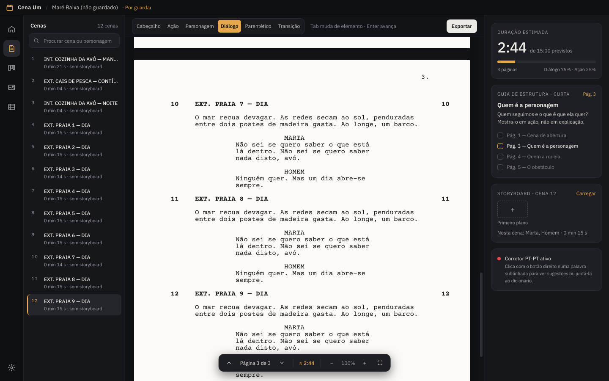
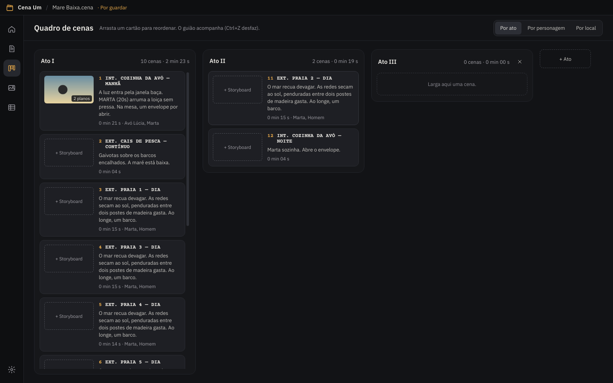
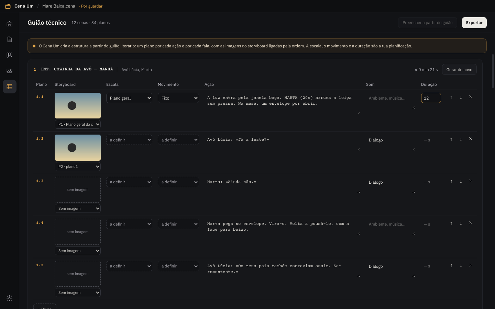

# Cena Um

Programa gratuito de escrita de guiões para cinema, televisão e teatro, feito em português de Portugal para Windows.



## Descarregar

Vai a **[Releases](../../releases)** e descarrega o `Cena-Um-…-instalador.exe` mais recente.

Se já tiveres o Cena Um instalado, o instalador mostra **Atualizar** (versão antiga) ou **Reparar** (mesma versão). Os teus guiões não são tocados.

O instalador ainda não tem assinatura digital. Na primeira vez, o Windows mostra "O Windows protegeu o computador". Para continuar, carrega em **Mais informações** e depois em **Executar mesmo assim**.

## O que já faz

- **Editor de guião** com os seis elementos (Cabeçalho, Ação, Personagem, Diálogo, Parentético, Transição) em Courier 12 pt, A4 ou Carta.
- **Teclado de argumentista**: Tab muda de elemento, Enter avança para o elemento lógico seguinte, Ctrl+1 a Ctrl+6 escolhe o elemento.
- **Automatismos**: escrever `int.` ou `ext.` cria um cabeçalho; `(` no diálogo cria um parentético; `CORTA PARA:` vira transição.
- **Autocompletar** personagens, locais e momentos do dia (Enter ou → aceita).
- **Paginação real** com quebras de página visíveis e **duração estimada** (1 página ≈ 1 minuto), por guião e por cena. Os parágrafos vazios não contam para a duração.
- **Cenas bem demarcadas**: espaço extra antes de cada cabeçalho e entre a personagem e a fala.
- **Guia de estrutura** com perguntas por página, só nas curtas-metragens.
- **Storyboard por cena**: carregar imagens, legendar, reordenar.
- **Cartaz** do projeto, usado como capa nos recentes e (opcional) na folha de rosto do PDF.
- **Formatação livre com o botão direito**: tipo de letra, tamanho, cor, negrito, itálico, sublinhado, riscado e alinhamento (esquerda, centro, direita, justificado). A duração estimada não muda com a formatação.
- **Corretor ortográfico PT-PT** do Windows (botão direito para sugestões).
- **Papel escuro** opcional para escrever (o PDF sai sempre branco).
- **Séries de TV**: todos os episódios e temporadas num só projeto, com ecrã de Episódios (título, sinopse, páginas, duração), troca rápida de episódio e personagens, locais e atos partilhados. Exporta o episódio aberto, todos ou só os que escolheres.
- **Desfazer, refazer e histórico**: botões na barra do guião e um histórico agrupado por momentos (pausas na escrita, mover cenas, formatar, colar) para voltar a qualquer ponto desde que abriste o guião.
- **Personagens**: ecrã próprio com descrição, falas, cenas onde falam e onde aparecem sem falar; acrescenta personagens que não têm falas e corrige à mão as cenas onde cada uma fala ou aparece (as correções valem também para o Levantamento).
- **Levantamento**: por cena (INT/EXT, local, momento, páginas em oitavos, personagens, figurantes, adereços, guarda-roupa, caracterização, cenografia, veículos, animais, efeitos, som) e resumo por local e por personagem; exporta PDF e folha de cálculo. Seleciona uma palavra no guião e usa o botão direito para a juntar ao levantamento.
- **Quadro de cenas**: cartões por ato, arrastar e largar para reordenar (com scroll automático junto às margens) (o guião acompanha; Ctrl+Z desfaz), atos com nome editável, vistas por personagem e por local.
- **Storyboard completo**: todas as cenas com as suas imagens, legendas, reordenar e arrastar imagens do Explorador.
- **Guião técnico**: estrutura gerada do guião (um plano por ação e por fala, storyboard ligado), com escala, movimento, som e duração; exporta PDF horizontal e folha de cálculo (.csv).
- **Peças de teatro** no formato próprio do texto dramático: falas a toda a largura, nome da personagem centrado, didascálias recuadas e em itálico, cabeçalhos de ato/cena centrados e página de personagens no PDF. Sem storyboard nem guião técnico, que não fazem sentido em palco.
- **Folha de rosto editável** nas definições do projeto: crédito, autoria (vários nomes), «baseado em», versão, data, contactos e direitos, com pré-visualização. Vai para o PDF, o Final Draft e o Fountain.
- **Tema escuro ou claro** (Definições → Aparência).
- **Equipa**: ficha técnica por departamentos com funções já preenchidas (cinema/TV ou teatro), onde acrescentas funções e departamentos; nome, contacto, residência e notas por pessoa. Exporta PDF e folha de cálculo.
- **Personagens em toda a série**: em que episódios cada personagem fala ou aparece, com total de falas e tempo de diálogo.
- **Ficheiros**: guarda em `.cena`, gravação automática configurável (1, 5 ou 10 minutos, ou desligada; 5 por defeito) e cópia de segurança dos guiões ainda sem ficheiro, recuperada se o programa fechar de repente; exporta PDF, Final Draft (`.fdx`) e Fountain; importa `.fdx` e `.fountain`.

## Imagens

| Quadro de cenas | Guião técnico |
|---|---|
|  |  |

## Atalhos

| Atalho | Ação |
|---|---|
| Ctrl+N | Novo projeto |
| Ctrl+O | Abrir |
| Ctrl+S / Ctrl+Shift+S | Guardar / Guardar como |
| Ctrl+P | Exportar |
| Ctrl+B / I / U | Negrito / itálico / sublinhado |
| Shift+Enter | Novo bloco do mesmo tipo |
| Esc | Sair do modo foco |

## Para programadores

```
npm install
npm run build      # compila a interface
npm start          # abre o programa
npm run dist       # gera o instalador para Windows (em release/)
```

Electron + React + TypeScript + ProseMirror. A paginação está em `src/editor/layout.ts`; os automatismos e o teclado em `src/editor/plugins.ts`; as cores e medidas em `src/styles.css` (`:root`).

## Próximas ideias

Guias de estrutura para longas e séries, revisões com cores, relatório de personagens e locais, colaboração.

## Licença

O Cena Um é software livre, distribuído sob a [GNU GPL 3.0](LICENSE). Podes usá-lo, estudá-lo, alterá-lo e partilhá-lo. Quem distribuir uma versão alterada tem de a publicar também sob a GPL 3.0, com o código aberto.

© 2026 Alexandre Serras.

O programa inclui componentes de código aberto de terceiros, com licenças compatíveis: MIT (React, ProseMirror, Electron) e SIL Open Font License 1.1 (fontes Courier Prime e IBM Plex Sans). Os textos completos estão em [`TERCEIROS.txt`](TERCEIROS.txt), que acompanha o instalador, e em `LICENSE.electron.txt` / `LICENSES.chromium.html`, na pasta de instalação.
